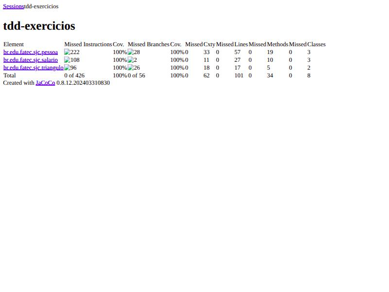

# Exercícios Práticos de TDD

Atividade de 26/10

Três exercícios resolvidos pelo ciclo **Red → Green → Refactor**, em um único
projeto Maven, com cobertura medida por **JaCoCo**.

| | |
|---|---|
| Linguagem | Java 17 |
| Testes | JUnit 5 (Jupiter) 5.10.2 |
| Build | Maven 3.9 |
| Cobertura | JaCoCo 0.8.12 |
| **Total de testes** | **77, todos passando** |
| **Cobertura** | **100%** de instruções, branches, linhas e métodos |

---

## Build

Compila o código de produção e os testes:

```bash
mvn clean compile
```

## Execução dos testes

```bash
mvn test
```

Saída esperada:

```
[INFO] Tests run: 77, Failures: 0, Errors: 0, Skipped: 0
[INFO] BUILD SUCCESS
```

Para rodar os testes de um exercício específico:

```bash
mvn test -Dtest=TrianguloTest
mvn test -Dtest=PersonDAOTest
mvn test -Dtest=CalculadoraSalarioTest
```

## Relatório de cobertura

O `verify` roda os testes e gera o relatório do JaCoCo:

```bash
mvn clean verify
```

O relatório HTML fica em `target/site/jacoco/index.html`:

```bash
xdg-open target/site/jacoco/index.html
```

---

# Evidências de cobertura de código

Relatório gerado por `mvn clean verify` (JaCoCo 0.8.12).



## Consolidado

| Pacote | Instruções | Branches | Linhas | Métodos | Classes |
|---|---|---|---|---|---|
| `br.edu.fatec.sjc.triangulo` | 100% (96) | 100% (26) | 17 | 5 | 2 |
| `br.edu.fatec.sjc.pessoa` | 100% (222) | 100% (28) | 57 | 19 | 3 |
| `br.edu.fatec.sjc.salario` | 100% (108) | 100% (2) | 27 | 10 | 3 |
| **Total** | **100% — 0 de 426 perdidas** | **100% — 0 de 56 perdidas** | **101** | **34** | **8** |

## Por exercício

### Exercício 1 — Triângulo — 19 testes

| Classe | Instruções | Branches | Linhas | Métodos |
|---|---|---|---|---|
| `Triangulo` | 100% (69) | 100% (26) | 12 | 4 |
| `Triangulo.Tipo` | 100% (27) | — | 5 | 1 |

### Exercício 2 — `isValidToInclude()` — 36 testes

| Classe | Instruções | Branches | Linhas | Métodos |
|---|---|---|---|---|
| `PersonDAO` | 100% (159) | 100% (28) | 35 | 8 |
| `Person` | 100% (43) | — | 14 | 7 |
| `Email` | 100% (20) | — | 8 | 4 |

### Exercício 3 — Calculadora de salário — 22 testes

| Classe | Instruções | Branches | Linhas | Métodos |
|---|---|---|---|---|
| `CalculadoraSalario` | 100% (17) | — | 4 | 2 |
| `Cargo` | 100% (64) | 100% (2) | 13 | 3 |
| `Funcionario` | 100% (27) | — | 10 | 5 |

---

# Exercício 1 — Triângulo

**Enunciado.** O programa lê três valores inteiros que representam os lados de um
triângulo e informa se os lados formam um triângulo isósceles, escaleno ou
equilátero. Condição: a soma de dois lados tem que ser maior que o terceiro lado.

**Classe:** `br.edu.fatec.sjc.triangulo.Triangulo`
**Testes:** `TrianguloTest` — 19 casos

```java
public Tipo classificar(int a, int b, int c)   // EQUILATERO | ISOSCELES | ESCALENO | INVALIDO
```

**Decisão de projeto.** Entradas inválidas retornam `Tipo.INVALIDO` em vez de lançar
exceção. Isso mantém um único valor de retorno para todos os casos e permite
expressar a tabela de decisão inteira com `@ParameterizedTest`.

A condição do enunciado é estrita (`soma > terceiro`), então o caso em que a soma
de dois lados é **igual** ao terceiro é inválido — é o triângulo degenerado, que
tem área zero e os três vértices colineares.

### Mapa dos casos de teste exigidos

| # | Situação pedida | Caso de teste | Valores | Esperado |
|---|---|---|---|---|
| 1 | Escaleno válido | CT01 | 3, 4, 5 | `ESCALENO` |
| 2 | Isósceles válido | CT02 | 5, 5, 8 | `ISOSCELES` |
| 3 | Equilátero válido | CT03 | 7, 7, 7 | `EQUILATERO` |
| 4 | ≥ 3 CTs isósceles com permutação dos mesmos valores | CT04.1–04.3 | 5,5,8 / 5,8,5 / 8,5,5 | `ISOSCELES` |
| 5 | Um valor zero | CT05.1–05.3 | 0,4,5 / 3,0,5 / 3,4,0 | `INVALIDO` |
| 6 | Um valor negativo | CT06.1–06.3 | -3,4,5 / 3,-4,5 / 3,4,-5 | `INVALIDO` |
| 7 | Soma de 2 lados igual ao terceiro | CT07 | 2, 3, 5 | `INVALIDO` |
| 8 | Um CT para cada permutação do item 7 | CT08.1–08.3 | 2,3,5 / 2,5,3 / 5,2,3 | `INVALIDO` |
| 9 | Soma de 2 lados menor que o terceiro | CT09 | 1, 2, 10 | `INVALIDO` |
| 10 | Um CT para cada permutação do item 9 | CT10.1–10.3 | 1,2,10 / 1,10,2 / 10,1,2 | `INVALIDO` |
| 11 | Os três valores iguais a zero | CT11 | 0, 0, 0 | `INVALIDO` |

Os itens 4, 5, 6, 8 e 10 usam `@ParameterizedTest` com `@CsvSource`: cada linha
do CSV é executada e reportada como um caso de teste independente.

---

# Exercício 2 — `isValidToInclude()`

**Enunciado.** Implementar, por TDD, o método que retorna uma **lista de erros** com
base no objeto `Person` recebido.

**Classes:** `Person`, `Email`, `PersonDAO` (pacote `br.edu.fatec.sjc.pessoa`)
**Testes:** `PersonDAOTest` — 36 casos

```java
public List<String> isValidToInclude(Person p)   // lista vazia = objeto válido
```

### Regras implementadas

| Regra | Validação | Mensagem |
|---|---|---|
| 1 | Nome com ao menos 2 partes, só letras | `ERRO_NOME` |
| 2 | Idade no intervalo `[1, 200]` | `ERRO_IDADE` |
| 3 | Ao menos um `Email` associado | `ERRO_SEM_EMAIL` |
| 4 | Formato `___@___.___`, cada parte com ≥ 1 caractere | `ERRO_EMAIL_INVALIDO` + o e-mail |

### Decisões de projeto

**Sem curto-circuito.** Todas as regras são avaliadas sempre, mesmo que uma já
tenha falhado. Um `Person` inválido nos três critérios retorna os três erros de
uma vez — o chamador recebe tudo o que precisa corrigir numa única passada, em
vez de descobrir um problema por vez.

**Mensagens como constantes públicas.** Os testes referenciam
`PersonDAO.ERRO_NOME` em vez de repetir o texto literal. Mudar o texto de uma
mensagem não quebra a suíte.

**Acentuação aceita no nome.** A validação usa `\p{L}` (qualquer letra Unicode) e
não `[A-Za-z]`, senão "João Gonçalves" seria rejeitado.

**Domínios de múltiplos níveis no e-mail.** A regex aceita
`contato@fatec.sp.gov` além de `joao@exemplo.com`, mantendo a exigência de que
nenhuma parte seja vazia — `joao@.com` e `joao@exemplo.` continuam inválidos.

**`save()` usa a validação como guarda.** O diagrama exige o método; ele persiste
em memória e lança `IllegalArgumentException` quando `isValidToInclude()` acusa
qualquer erro.

---

# Exercício 3 — Calculadora de salário

**Enunciado.** Calcular o salário líquido de um funcionário (nome, e-mail,
salário-base e cargo), com desconto que depende do cargo e de uma faixa salarial.

**Classes:** `Funcionario`, `Cargo`, `CalculadoraSalario` (pacote `br.edu.fatec.sjc.salario`)
**Testes:** `CalculadoraSalarioTest` — 22 casos

```java
public double calcularSalarioLiquido(Funcionario funcionario)
```

### Regras

| Cargo | Salário de corte | Desconto a partir do corte | Desconto abaixo |
|---|---|---|---|
| `DESENVOLVEDOR` | 3.000,00 | 20% | 10% |
| `DBA` | 2.000,00 | 25% | 15% |
| `TESTADOR` | 2.000,00 | 25% | 15% |
| `GERENTE` | 5.000,00 | 30% | 20% |

### Estratégia de teste: valores de fronteira

O risco real deste exercício é o operador errado na comparação (`>` no lugar de
`>=`). Por isso cada cargo é testado nos três pontos ao redor do corte — logo
abaixo, exatamente no corte e logo acima:

| Cargo | Base | Líquido esperado | Faixa |
|---|---|---|---|
| `DESENVOLVEDOR` | 2.999,99 | 2.699,99 | ainda 10% |
| `DESENVOLVEDOR` | 3.000,00 | 2.400,00 | já 20% |
| `DESENVOLVEDOR` | 3.000,01 | 2.400,01 | 20% |
| `DBA` / `TESTADOR` | 1.999,99 | 1.699,99 | ainda 15% |
| `DBA` / `TESTADOR` | 2.000,00 | 1.500,00 | já 25% |
| `GERENTE` | 4.999,99 | 3.999,99 | ainda 20% |
| `GERENTE` | 5.000,00 | 3.500,00 | já 30% |

### A fase Refactor

A primeira versão aprovada pelos testes era um `switch` que concentrava as regras
de todos os cargos na calculadora, com as linhas de `DBA` e `TESTADOR` idênticas:

```java
return switch (funcionario.getCargo()) {
    case DESENVOLVEDOR -> base >= 3000.00 ? base * 0.80 : base * 0.90;
    case DBA           -> base >= 2000.00 ? base * 0.75 : base * 0.85;
    case TESTADOR      -> base >= 2000.00 ? base * 0.75 : base * 0.85;
    case GERENTE       -> base >= 5000.00 ? base * 0.70 : base * 0.80;
};
```

Com os testes verdes servindo de rede de segurança, a regra foi movida para
dentro do próprio `Cargo`, que passou a conhecer a própria faixa:

```java
public double calcularSalarioLiquido(Funcionario funcionario) {
    double base = funcionario.getSalarioBase();
    double desconto = funcionario.getCargo().descontoPara(base);

    return base * (1.0 - desconto);
}
```

Incluir um novo cargo passou a ser **uma linha no enum**, sem tocar na
calculadora. Nenhum teste precisou ser alterado na refatoração — é exatamente
essa a garantia que o TDD oferece.

### Sobre `double` e valores monetários

O projeto usa `double` para o salário, acompanhando o estilo adotado na
disciplina, e as asserções usam uma tolerância de `0.01`. Em um sistema de folha
de pagamento real o tipo correto seria `BigDecimal`, que não sofre com erro de
representação binária e permite controlar explicitamente o arredondamento.

---

## Estrutura do projeto

```
tdd-exercicios/
├── pom.xml
├── README.md
├── docs/
│   └── cobertura-jacoco.jpg
└── src/
    ├── main/java/br/edu/fatec/sjc/
    │   ├── triangulo/     Triangulo
    │   ├── pessoa/        Person, Email, PersonDAO
    │   └── salario/       Funcionario, Cargo, CalculadoraSalario
    └── test/java/br/edu/fatec/sjc/
        ├── triangulo/     TrianguloTest
        ├── pessoa/        PersonDAOTest
        └── salario/       CalculadoraSalarioTest
```
